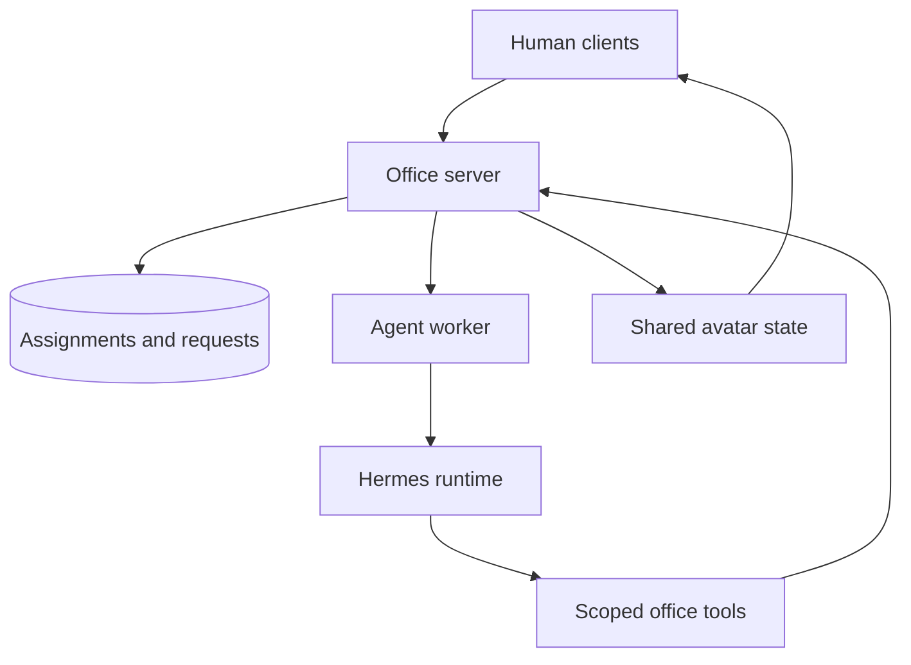

# Shared office agent roadmap

Status: implementation proposal; no agent runtime or avatar integration is claimed complete.
Decisions confirmed with Cameron on October 27, 2026. Repository reviewed at `5ab9dbe4c1cae0b74c5512d3c4ee3c191eb9f129`.

## Product goal and confirmed scope

Give the office one shared AI teammate that completes a delegated deliverable, asks the right people for missing information or permission, waits when necessary, and resumes without the requester relaying every message.

Confirmed decisions:

- One shared office agent for the October 27 evening demo. Every assignment still has a named human requester.
- Demonstrate a completed deliverable, including a real cross-user question and response.
- Allow autonomous follow-through within an explicitly assigned goal. Independently discovering and starting unrelated work is deferred. Broader monitoring would require separate opt-in.

The recommendations below are implementation defaults, not additional product choices already confirmed by Cameron: text-first interaction; a demo launch brief as the initial deliverable; scoped tool access; queued requests for unavailable people; and a separate approval before sharing a finished draft.

## First complete demonstration

Suggested assignment: "Prepare a demo launch brief from our shared demo tasks. Ask Nathan for the confirmed shared office URL and James for the agreed audio-test procedure if those details are missing. Give me a finished draft to review."

Use explicitly shared task data and answers for this slice. Do not depend on recorded meetings, private notes, Slack, GitHub writes, or live audio transcription. The shared office/audio deployment is a separate prerequisite being handled by the team; an agent can gather its confirmed details but cannot invent them or fix deployment by talking about it.

1. Cameron assigns the goal and sees the allowed sources, permitted contacts, output audience, and usage cap. Starting authorizes those in-office questions within this assignment.
2. The agent reads permitted shared tasks and identifies a specific information gap.
3. Everyone sees the same identifiable agent avatar. It approaches Nathan; Nathan receives a private request card explaining the question, requester, and who will receive his answer.
4. Nathan answers in text. Busy or offline Nathan gets a persistent inbox item instead of an interrupting popup. The agent can finish independent portions while waiting.
5. The agent incorporates the answer, obtains any other required input, and produces the brief. Missing or conflicting facts remain labeled; a partial output is not marked complete.
6. Cameron reviews the exact draft and approves publication to the named office audience, or requests edits. Publication records the artifact revision and happens once. Rejecting publication leaves the draft available privately.
7. The agent reports the outcome and returns to its home position.

The brief contains the confirmed office URL, join instructions, near/far and private-room audio test steps, known issues, named sources, and outstanding questions. "Source" means a real task revision or attributed answer, not an invented citation. An unverified link is labeled supplied/unverified.

For an offline fixture demo, label the mode and fictional data clearly. It can exercise questions, approvals, and persistence with a deterministic runtime adapter, but it is not evidence of live autonomous reasoning. Acceptance of the live-agent claim requires a real bounded model run.

## Recommended architecture

Keep office workflow and authorization in the existing TypeScript server. Run Hermes separately behind a replaceable `AgentRuntime` adapter. The browser communicates with the office server, never directly with privileged agent services.

Responsibilities:

| Component | Owns |
| --- | --- |
| Office server | Identity, task scope, authorized context, recipient routing, request/approval validation, artifact access, notification policy, audit history |
| Durable queue and worker | Run leases, bounded execution, wake-up after replies, cancellation, retries of known-safe operations, reconciliation |
| Runtime adapter | Start/continue/stop a reasoning turn; translate tool calls and progress; report success, failure, or waiting accurately |
| Hermes | Reasoning and permitted tool selection within the delegated goal; optional skills later |
| Frontend and Colyseus | Consistent avatar position/status, request cards, inbox, activity view, artifact review |

### Why try Hermes first

Hermes documents programmatic HTTP/SSE and JSON-RPC interfaces, run lifecycle events, approvals, clarification requests, plugins, and scheduled/event-triggered work. This makes it a plausible worker runtime without embedding a terminal UI in the office.

Start by testing the HTTP runs interface for execution/progress/stop and a small custom office-tool plugin for business questions. If the selected version cannot support the needed question bridge, evaluate its documented JSON-RPC clarification interface. The office retains durable business requests in either case.

Do not assume a Hermes command approval is equivalent to a project owner's approval, that a session transcript is a durable business workflow, or that all integration transports have identical restart behavior. Pin and test an exact release/commit before committing to the adapter. Keep the Gemini provider for the initial integration where supported; do not add an automatic provider fallback.

LangGraph TypeScript is the alternative if Hermes integration consumes the demo window. It supplies persisted execution and human-input interrupts, but requires more agent/tool behavior to be assembled. Choose one runtime for the initial slice; do not stack both frameworks. A deterministic fixture adapter remains useful for tests under either choice.

### Durable waiting, not a browser-held promise

Persist a human request before presenting it. Waiting for someone must release the worker lease and incur no continuing model calls. After an authorized reply, enqueue the next reasoning turn with the stored task context and answer.

The Hermes adapter must prove that it can safely checkpoint or end a turn at a human-input boundary and later continue it. A tool result saying "pending" must not allow the runtime to continue as though the answer or permission had arrived. If this cannot be enforced, the live adapter does not pass its integration gate.

The durable office request survives a browser disconnect, worker crash, or runtime restart even if an underlying runtime prompt expires. Bind runtime request IDs to office request IDs; reconcile expired runtime requests without treating them as consent or silently reissuing actions.

## Fit with the current repository

| Existing foundation | Reuse and required extension |
| --- | --- |
| `server/src/services/OfficeAssistant.ts` | Existing bounded, read-only Gemini analysis and authorized source selection. Preserve existing explicit-invocation behavior; add a separate agent execution service. |
| `server/src/services/CollaborationService.ts` and `server/migrations/004_collaboration.sql` | Reuse directory, shared tasks, private desk messages, revisions, and idempotency patterns. Add agent principals, human requests, artifacts, and task execution records. |
| Existing reviewed message drafts | Reuse the review interaction pattern. Current drafts require a saved-note source and human owner; they cannot directly stand in for arbitrary agent questions. |
| `server/src/rooms/OfficeRoom.ts` and `shared/src/protocol.ts` | Add a distinct agent collection and public agent events. Agents are not guest users or audio participants. |
| `shared/src/navigation.ts`, `frontend/renderer.js`, `frontend/main.ts` | Reuse map/path concepts and panel layout; add a visibly distinct agent sprite, states, request cards, and activity view. Existing renderer types currently describe human players. |
| Existing interruption preference | Enforce it on the server before active delivery. A declined interruption does not discard the persistent request. |
| Existing usage tracker | Extend accounting to every runtime model call, including auxiliary or nested calls. A separate Hermes key must not bypass office limits. |

The older `docs/AI_COLLABORATION_ROADMAP.md` describes explicit requests and no background inference. This proposal adds delegated follow-through only for users who start an agent assignment; enabling agents must not silently change the existing assistant or introduce inference on every presence/task event.

Use the normal persistent office for cross-device and restart acceptance. The current `office:demo` launcher is deliberately loopback-only with an in-memory database; do not promise cross-laptop access or restart durability from that mode. Any future shared seeded mode needs an explicit design separate from removing its existing restrictions.

Proposed modules: `server/src/services/AgentRunService.ts`, `AgentRequestService.ts`, `AgentArtifactService.ts`; `shared/src/agents.ts`; and a separate `agent-worker/` with an `AgentRuntime` interface. These paths are proposals, not existing files. Keep the current consent-based transcription worker separate.

## Identity, context, and permissions

The agent has its own service identity. Each run is bound to an office, requester, allowed context, allowed contacts, approved tools, and budget. A person's reply does not transfer that person's account privileges to the agent.

Minimal tool surface:

| Tool | Allowed behavior for the first slice |
| --- | --- |
| `read_shared_tasks` | Read the authorized office/task scope at execution time |
| `find_office_person` | Resolve an explicit office user ID; ambiguous matches require clarification |
| `ask_person` | Persist a scoped question to an allowed recipient, with reason and answer audience |
| `request_approval` | Persist an exact proposed action, resource, revision, audience, expiry, and authorized approver |
| `save_artifact_draft` | Save a versioned draft and evidence references in the office application |
| `publish_approved_artifact` | Publish only the exact approved revision to the approved audience after server checks |

The agent chooses what information it needs; deterministic server code decides whether it may ask, read, or act. Animation and proximity grant no access. Disable unnecessary terminal, filesystem, browser, external messaging, delegation, and autonomous scheduling tools for the first slice. Keep privileged credentials and runtime endpoints inaccessible to clients and the worker's unneeded tools.

Separate three concepts:

- **Information:** a person supplies a fact, with attribution and stated audience. It can be disputed or corrected.
- **Authorization:** an entitled person permits one concrete action. It is not a fact about project scope or a general permission grant.
- **Preference:** a person permits interruptions or chooses agent behavior. It does not authorize disclosure or resource changes.

Start with shared task context and explicit answers. Private meeting notes, desk messages, and transcripts stay excluded from agent context for tonight. Later, shared agents need per-run access boundaries and audience-aware retrieval; one global conversation history or memory store must not mix private contexts across requesters.

Give each assignment an isolated runtime session. Disable shared runtime memory/skill learning for tonight, and reconstruct continuation from that assignment's authorized state. A shared avatar does not justify loading another run's conversation into the next request.

Show the intended answer audience before submission. For the initial scenario, answers may be used in the requester-visible draft and the named office publication only if the respondent explicitly permits that audience. Otherwise retain the narrower audience and request a shareable version. Recheck evidence access and audience authorization before publishing; do not just remove citations while retaining restricted facts.

No passive microphone listening or recording is introduced by an avatar. Any future speech interaction must use explicit audio consent and the existing meeting/privacy boundaries.

## Workflow and persistence contract

Suggested run states: `queued`, `working`, `waiting_for_person`, `waiting_for_approval`, `ready_for_review`, `completed`, `partial`, `failed`, `canceled`. A run can have several independent open requests; closing one must not satisfy another. Cancellation is an absorbing state for future work and approvals.

Persist at minimum:

- `agent_runs`: office/requester, goal, scope, state/revision, runtime session reference, budget/usage, cancellation, lease owner/expiry, timestamps.
- `agent_requests`: run, recipient/approver, question or action type, payload/revision, answer audience, expiry, status, response and actor. Approval binds a canonical action payload and artifact revision.
- `agent_artifacts`: run, revision, draft content, evidence IDs/revisions, audience grants, review/publication state.
- `agent_events`: per-run ordered durable events and visibility metadata; sensitive contents are never broadcast publicly.
- `agent_outbox`: idempotent delivery/execution records for notifications and approved publication.

Enforce foreign keys, office membership, unique request/idempotency keys, and revision checks. Wake-up events are durable and consumed under a lease; polling reconnects cannot start a second worker for the same turn. Use short transactions; never hold SQLite locks across model calls or human waits.

Request responses are authenticated on the server and checked against the intended recipient, current membership, status, revision, and expiry. Duplicate submissions replay the same result. A changed artifact, action, recipient, or audience requires fresh approval. Revalidate immediately before execution; silence, timeout, walking nearby, and natural-language encouragement are not approval.

Persisted events allow clients to replay from an event cursor after reconnect. Commit state changes and outbox records together. For external effects in later phases, uncertain outcomes require reconciliation or human review, not blind retry; do not claim global exactly-once execution.

## Avatar and interruption experience

- Use one distinct shared sprite with an agent badge and a named assignment sponsor.
- Public states are deliberately generic: working, walking, waiting, ready. Never put private question text, private task titles, recipient details, or answers in public bubbles or replicated state.
- A server-owned controller selects a reachable approach point and updates one shared position. Use deterministic pathfinding/movement; never call an LLM for animation frames or position ticks. Keep agents nonblocking for human collision and outside all audio rosters.
- Walking communicates intent; it does not gate correctness. If the recipient moves or a route fails, keep the request accessible in the inbox.
- Show a small card to an interruption-enabled, available recipient. Busy, away, meeting, offline, or opted-out recipients receive a queued inbox item without sound or focus theft.
- Request cards show the human requester, why this person was selected, the needed answer/action, intended audience, and Reply/Decline/Later or Approve/Reject controls. "Later" is not approval and never extends permissions.
- Everyone can open the agent's authorized activity view. Detailed run content follows access rules; people outside its audience get only generic status. Provide requester Stop and visible failure/waiting reasons.

## Tonight's build order

Assign owners at kickoff; the order below describes dependencies, not promised completion times. Avoid optional features until the complete path works.

| Order | Deliverable | Acceptance gate |
| --- | --- | --- |
| 0 | Confirm the shared office deployment and pin the runtime; run a small Hermes tool/ask/stop experiment | A real tool call reaches the office server; a question pauses work; an answer resumes it; stopping prevents later actions. If this fails, timebox the runtime work and use an honestly labeled fixture demo. |
| 1 | Run/request/artifact schema and authenticated services | Two users see only permitted data; a question and draft survive restart; duplicate replies do not create duplicate work. |
| 2 | Request inbox and review cards with a fixture runtime | Assign -> question -> response -> draft -> approval -> publication works across two real user sessions. |
| 3 | Shared agent avatar and deterministic movement | Both clients see the same agent; no private content appears in broadcast state; busy/offline routing works. |
| 4 | Bounded live runtime through the same contracts | It finds a missing fact, asks a relevant person, uses their actual answer, and produces an evidence-linked artifact. Missing facts stay unknown. |
| 5 | Rehearse the complete story and failure paths | Two laptops complete the story; reject, edit-after-approval, cancel, offline reply, and restart cases behave correctly. |

Start with one active run for the office, at most two named contacts, one initial question per contact, and no automatic reminder/repeated pestering. Proposed initial cap: six total model requests per assignment, including continuation and auxiliary calls, bounded tool steps, and a configured wall-clock execution timeout excluding human waits. Tune only after measuring. The existing default daily limit is 20 provider requests, so budget the rehearsal and demo together and record actual usage.

Disable hidden runtime retries, auxiliary models, or nested delegation unless they are counted and bounded. Quota exhaustion ends in a visible partial/waiting/failed state. Idle/waiting agents consume no model calls. New replies may resume only their assigned workflow; presence changes can affect delivery, not trigger unrelated analysis. A denied request must not cause the agent to ask another person to bypass that decision.

### Scope cuts if time is tight

Keep the real human request/reply and durable continuation. Simplify the deliverable to one short brief and the avatar to a few existing animation states. If necessary, defer office-wide publication and show a requester-visible completed draft, but label the approval/publication milestone unimplemented. Cut voice, external integrations, personal agent fleets, automatic task discovery, and skill learning first. Do not present fixture behavior as a live model demonstration or same-browser testing as separate-device verification.

## Required checks and demo evidence

Run the existing `npm run office:verify` offline regression checks after implementation, plus targeted tests of the actual agent services. Do not run unbounded live evaluations.

| Check | Required result |
| --- | --- |
| Complete deliverable | A real answer from a second user changes the resulting draft; supported claims cite actual sources. |
| Wrong recipient/office | Another user or office cannot view/answer a request, approve it, or retrieve restricted run content. |
| Permission scope | An answer never grants a permission; altered/expired approvals fail; publication checks exact content and audience. |
| Duplicate/replay | Double-clicks, reconnects, and worker lease races do not duplicate questions, replies, continuation, or publication. |
| Restart/offline | Restart during a human wait retains the request; a later reply resumes one run. Unknown execution is reconciled, not blindly rerun. |
| Decline/cancel | Rejection is respected; canceled jobs and late approvals cannot produce new effects. |
| Availability | Busy/meeting/opted-out users are not actively interrupted; the inbox retains their request. |
| Shared visibility | Agent position is consistent across clients; public payloads contain no private question or artifact content. |
| Model behavior | Missing evidence produces a question or uncertainty; task text and answers cannot override tool policy. |
| Budget/failure | Provider timeout/quota failure is visible, bounded, and does not claim completion or secretly switch providers. |

Record commit/runtime version, participants/devices, fixture versus live mode, model request count, end-to-end outcome, and any remaining limitations. Synthetic tests complement the two-person rehearsal; they do not establish human usability or separate-laptop connectivity.

## After the demo

1. Improve recipient selection, batching, quiet hours, question quality, correction handling, and authorized long-term memory.
2. Add opt-in event monitoring with deduplication, relevance checks, explicit project scope, and per-office cost limits.
3. Add scoped external tools and delegated credentials. Start with drafts/review; implement effect reconciliation before real sends or writes.
4. Add personal agents and agent-to-agent delegation while preserving principal, context, and budget boundaries.
5. Consider voice questions and richer pet-like behaviors after text requests and permissions are reliable.

Do not make tonight's path depend on these later milestones.

## Research references

Reviewed October 27, 2026. Framework documentation describes available interfaces, not verified compatibility with this repository. Recheck against the pinned runtime before implementation.

- [Hermes programmatic integration](https://hermes-agent.nousresearch.com/docs/developer-guide/programmatic-integration): transports, lifecycle, questions, approvals, and stop interfaces.
- [Hermes API server](https://hermes-agent.nousresearch.com/docs/user-guide/features/api-server): run endpoints, authentication, event streaming, and recovery/idempotency semantics.
- [Hermes platform adapters](https://hermes-agent.nousresearch.com/docs/developer-guide/adding-platform-adapters): custom integration route if needed later.
- [Hermes security](https://hermes-agent.nousresearch.com/docs/user-guide/security): runtime approval, isolation, and unattended-mode behavior; distinct from office business authorization.
- [Hermes scheduling](https://hermes-agent.nousresearch.com/docs/user-guide/features/cron): scheduled/event-triggered work; deferred for the first assigned-goal slice.
- [LangGraph JavaScript interrupts](https://docs.langchain.com/oss/javascript/langgraph/interrupts) and [persistence](https://docs.langchain.com/oss/javascript/langgraph/persistence): alternative durable human-input orchestration. Resumed nodes can rerun preceding code, so effects still need idempotency.
